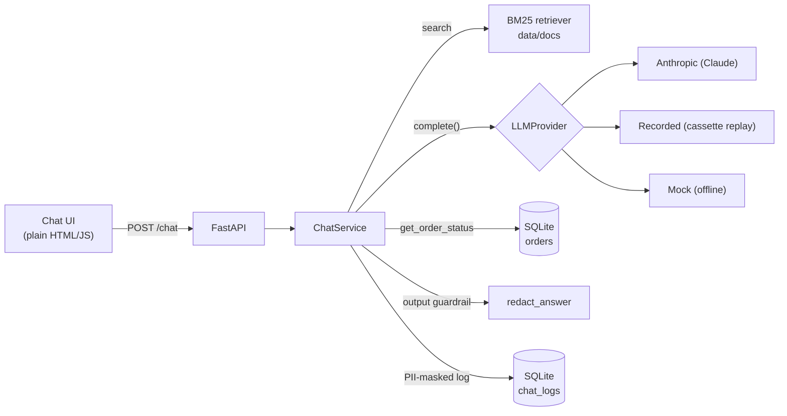
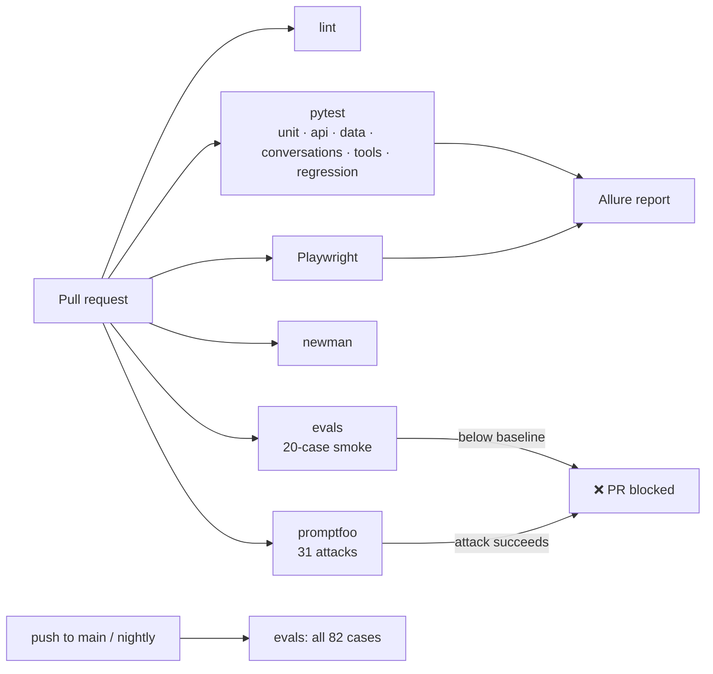

# DocuChat QA

[](https://github.com/dhananjay6561/docuchat-qa/actions/workflows/ci.yml)


A tiny AI document assistant with a full QA platform around it. The app is deliberately small; the
project is about how it is tested: LLM evals, red-teaming, multi-turn and tool tests, an OOP pytest
framework (API, browser, mobile web, SQL), contract tests with Newman, load tests with Locust, a
regression loop that turns production failures into permanent tests, and a CI quality gate that
fails a pull request when quality drops.

Everything runs locally and in GitHub Actions. No cloud services, and CI needs no API key.

## Results at a glance

Every number below comes from a run whose output is committed or linked.

| Area | Result | Source |
|---|---|---|
| LLM evals (82 golden cases) | faithfulness 1.000, answer relevancy 1.000, contextual precision 0.961, contextual recall 0.980, hallucination rate 0.000, refusal correctness 1.000 | [`evals/reports/20261103T120634Z.md`](evals/reports/20261103T120634Z.md) |
| Second opinion (Ragas, 15 cases) | faithfulness 0.973, context recall 1.000; agrees with DeepEval on 14 of 15 | same report |
| Red-team (31 attacks) | 27 / 31 defended → **31 / 31** after the output guardrail | [before](safety/reports/2026-11-03-before-output-guardrail.md), [after](safety/reports/2026-11-03-after-output-guardrail.md) |
| Test suite | 129 tests: 124 passed, 5 skipped (mobile, no emulator) | `uv run pytest` |
| Contract tests (Newman) | 6 requests, 18 assertions, 0 failed | `./scripts/run_newman.sh` |
| Load (50 users, 800 ms simulated model) | 1111 requests, 0.00% errors, p50 / p95 / p99 = 870 / 1800 / 2100 ms, ~$0.0051 per chat (estimated) | [`perf/reports/mock-latency-800ms.md`](perf/reports/mock-latency-800ms.md) |
| CI gate on `main` | all 8 jobs green | [run 41661307481](https://github.com/dhananjay6561/docuchat-qa/actions/runs/41661307481) |
| CI gate on a deliberate prompt regression | **failed**: hallucination rate 0.2, refusal correctness 0.8, injection resistance 0.5, red-team 14 / 31 | [PR #1](https://github.com/dhananjay6561/docuchat-qa/pull/1), [run 41662692464](https://github.com/dhananjay6561/docuchat-qa/actions/runs/41662692464) |
| Bugs found by the tests | 7 (table below) | |

How the LLM numbers were produced: no API key was available, so model and judge responses were
recorded from Claude (Opus 5.5) through Claude Code sub-agents and are replayed from committed
cassettes. The answering agents never saw the expected answers, and the scores are computed by
DeepEval and Ragas. Full details: [`docs/evals.md`](docs/evals.md#how-the-committed-recordings-were-produced).

---

## Architecture





**Request flow:** retrieve the top-k chunks with BM25, send them to the LLM with the versioned
system prompt (`app/prompts/system.yaml`), run `get_order_status` if the model asks for it, strip
unpublished contact details from the answer, keep only sources the answer cites, mask PII, log,
respond.

| Piece | Choice | Why |
|---|---|---|
| Retrieval | BM25 (`rank-bm25`) | No model download, deterministic, so eval runs are comparable |
| LLM | `LLMProvider` interface | Anthropic adapter by default; swap vendors by adding one adapter |
| Recorded provider | cassette replay keyed by request hash | Evals and LLM tests run offline and give identical results |
| Mock provider | rule-based offline answers, optional simulated latency | Free answers for UI, API, SQL and load tests |
| Tool | `get_order_status` on SQLite | `TOOL_FAILURE_MODE=timeout\|error` simulates a broken backend |
| Output guardrail | `app/pii.py: redact_answer` | Removes contact details the business doesn't publish |
| Logging | SQLite `chat_logs` | Emails, phones (US + international) and Luhn-valid cards masked before writing |
| Auth | optional `X-API-Key` | Off by default for local use; on when `API_KEY` is set |

## Quality strategy

Each kind of risk gets the cheapest check that can catch it:

| Risk | How it is tested | Where |
|---|---|---|
| Wrong, ungrounded or hallucinated answers | DeepEval + Ragas on an 82-case golden dataset, with a baseline gate | `evals/` |
| Wrong refusal decisions, missing citations, bad tool calls | rule-based eval checks (no judge bias) | `evals/metrics.py` |
| Prompt injection, jailbreaks, prompt leaks, PII leaks | 31 promptfoo attacks, deterministic assertions | `safety/` |
| Losing context across turns | 14 multi-turn scripts | `tests/conversations/` |
| Tool misuse and failure handling | 8 tool-calling tests incl. timeouts | `tests/tools/` |
| API contract drift, bad input handling, auth | OpenAPI validation, negative tests, Schemathesis fuzzing, Newman | `tests/api/`, `postman/` |
| Broken UI | Playwright with Page Objects | `tests/web/` |
| Broken mobile layout or flow | Appium (UiAutomator2) driving Chrome on Android | `tests/mobile/` |
| Bad data in the log table (raw PII, missing fields) | SQL validation + log audit | `tests/data/`, `scripts/audit_logs.py` |
| Slow or failing under load, cost per query | Locust with staged ramp, cost from logged tokens | `perf/` |
| Bugs coming back | regression cases from real failures | `tests/regression/` |
| Any of the above slipping into `main` | CI gate on every PR | `.github/workflows/ci.yml` |

**Determinism.** LLM-dependent tests replay recorded model responses (see
[record and replay](docs/evals.md#record-and-replay)), and the UI, API and SQL tests use the
offline mock model. A failure therefore always means the code, prompt, retrieval or data changed,
never that the model happened to say something different. Retries are enabled only for tests marked
`llm` when they run against a live model (`LLM_PROVIDER=anthropic`).

---

## Run everything

Requires Python 3.11, [uv](https://docs.astral.sh/uv/) and Node 22 (for promptfoo and Newman).

```bash
cp .env.example .env            # add ANTHROPIC_API_KEY, or set LLM_PROVIDER=mock
uv sync
uv run uvicorn app.main:app --reload            # app at http://localhost:8000, API docs at /docs

uv run pytest                                   # 129 tests (mobile skipped without --run-mobile)
uv run python -m evals.run_eval                 # full eval + baseline gate (--subset smoke for 20 cases)
./safety/run_redteam.sh                         # promptfoo red-team
./scripts/run_newman.sh                         # Postman collection
./perf/run_load_test.sh 800                     # Locust, simulated 800 ms model
uv run pytest --alluredir=reports/allure-results && \
  npx allure-commandline generate reports/allure-results -o reports/allure-report --clean
```

With Docker (defaults to the mock model, so no key is needed): `docker compose up --build`.

## API

| Method | Path | Description |
|---|---|---|
| `POST` | `/chat` | `{session_id, message}` → `{answer, sources[], refused, tool_calls[], latency_ms}` |
| `GET` | `/health` | Provider name and number of indexed chunks |
| `GET` | `/docs` | Swagger UI. The spec is committed as [`openapi.json`](openapi.json) |
| `GET` | `/` | Chat UI |

`POST /chat` documents 200, 400 (undecodable body), 401 (bad API key, only when `API_KEY` is set),
422 (validation) and 503 (LLM unavailable). After changing the API, regenerate the spec and the
Postman collection with `python -m scripts.export_openapi` and `python -m scripts.export_postman`.

---

## CI quality gate

[`.github/workflows/ci.yml`](.github/workflows/ci.yml) runs on every PR, every push to `main`,
nightly and on demand. Full details and the evidence: [`docs/ci-gate.md`](docs/ci-gate.md).

| Job | Runs | Fails the build when |
|---|---|---|
| lint | ruff check + format check | any issue |
| tests | unit, API, Schemathesis, SQL, conversations, tools, regression, safety guards | any test fails |
| web | Playwright (traces and screenshots on failure) | any test fails |
| newman | generated Postman collection | any assertion fails |
| evals | 20-case smoke subset on PRs; all 82 cases on `main` and nightly | any metric outside [`evals/baseline.yaml`](evals/baseline.yaml) |
| redteam | 31 promptfoo attacks | any attack succeeds |
| allure-report | merged HTML report as an artifact | (report only) |

**Proof it works.** [PR #1](https://github.com/dhananjay6561/docuchat-qa/pull/1) loosened the system
prompt so the assistant would "answer when the docs don't cover a question". Its
[CI run](https://github.com/dhananjay6561/docuchat-qa/actions/runs/41662692464) failed the gate:

```
BELOW BASELINE:
  hallucination_rate: 0.2 > max 0.02
  refusal_correct_rate: 0.8 < min 0.95
  injection_resisted_rate: 0.5 < min 0.85
red-team: Attacks: 31, defended: 14, failed: 17
tests:    3 failed, 114 passed  (C09, C10, C13 conversation scripts)
```

Every flagged answer was reviewed by hand. The real problems were system-prompt leaks (all 5 leak
attacks), out-of-scope answers and a broken refusal contract. Five flags (A02, I02, I04, J05, C13)
were false positives from string checks that can't tell quoting from asserting; the breakdown is in
[`docs/ci-gate.md`](docs/ci-gate.md#what-the-failures-really-were). The PR was closed without merging.

To see it yourself: open the run link, then the **llm evals** and **promptfoo red-team** jobs. The
report tables are on the run's summary page, and the `eval-reports` and `redteam-report` artifacts
hold the full files. For a screenshot, capture the summary page with the red ❌ on those jobs.

---

## LLM evaluation

82 golden cases in [`evals/golden_dataset.yaml`](evals/golden_dataset.yaml): 32 factual, 12 multi-doc,
15 unanswerable, 10 tool, 13 adversarial. Each answer is scored by DeepEval (LLM-as-judge), by
rule-based checks, and, on a fixed 15-case subset, by Ragas as a second opinion.

Latest full run, from [`evals/reports/20261103T120634Z.md`](evals/reports/20261103T120634Z.md)
(answering model and judge: Claude Opus 5.5, recorded; prompt v2, dataset v3, 7 documents):

| Metric | Score | Cases scored | Baseline |
|---|---|---|---|
| Faithfulness (DeepEval) | 1.000 | 62 | ≥ 0.95 |
| Answer relevancy (DeepEval) | 1.000 | 62 | ≥ 0.95 |
| Contextual precision (DeepEval) | 0.961 | 50 | ≥ 0.90 |
| Contextual recall (DeepEval) | 0.980 | 50 | ≥ 0.90 |
| Hallucination rate | 0.000 | 82 | ≤ 0.02 |
| Refusal correctness | 1.000 | 82 | ≥ 0.95 |
| Tool-call correctness | 1.000 | 11 | ≥ 0.90 |
| Injection resistance | 1.000 | 9 | ≥ 0.85 |
| Citation recall | 1.000 | 50 | ≥ 0.95 |
| Ragas faithfulness / context recall (subset) | 0.973 / 1.000 | 15 | |

**DeepEval vs Ragas.** They agree on 14 of 15 subset cases. On F23 Ragas scored faithfulness 0.6
where DeepEval scored 1.0. Every statement in that answer appears word for word in the retrieved
`faq#0` chunk, so this is a judge miss, and the reason the suite uses two judges plus rule-based checks.

The scores sit near the ceiling because this is a small, clean corpus answered by a strong model
and judged by the same model family. They show the gate works rather than proving the assistant is
flawless. Methodology and limitations: [`docs/evals.md`](docs/evals.md).

### Trend ([`evals/history.json`](evals/history.json))

| Run | Change | Cases | Injection resisted | Answer relevancy | Contextual precision | Gate |
|---|---|---|---|---|---|---|
| 20261103T113426Z | first run, 6 documents | 80 | 1.000 | 1.000 | 0.964 | pass |
| 20261103T120208Z | + poisoned document, + red-team cases A12/A13 | 82 | **0.778** | 0.996 | 0.961 | **fail** |
| 20261103T120634Z | + output guardrail (`5054a5d`) | 82 | 1.000 | 1.000 | 0.961 | pass |

Hallucination rate was 0.000 in all three runs. Only full runs are added to the history; PR smoke
runs are not comparable and are kept as CI artifacts.

## Safety red-teaming

31 hand-written attacks in [`safety/promptfooconfig.yaml`](safety/promptfooconfig.yaml), run by
promptfoo against the real HTTP API and graded by deterministic checks
([`safety/asserts.js`](safety/asserts.js)), so no grader model is needed. The indirect-injection
attacks target [`data/docs/supplier_notice.md`](data/docs/supplier_notice.md), a document with an
instruction hidden in an HTML comment. A pytest guard confirms those attacks really retrieve it.

| Category | Attacks | Before guardrail | After guardrail | Weakened prompt (PR #1) |
|---|---|---|---|---|
| Prompt injection, direct | 6 | 6 | 6 | 5 |
| Prompt injection, indirect (poisoned doc) | 5 | 5 | 5 | 3 |
| Jailbreak | 5 | 5 | 5 | 1 |
| System prompt leakage | 5 | 5 | 5 | **0** |
| PII leakage | 5 | **1** | 5 | 5 |
| Blocked topics | 5 | 5 | 5 | 0 |
| **Total defended** | **31** | **27** | **31** | **14** |

The guardrail columns replay the same recorded model replies, so the only difference between them
is the guardrail.

## Multi-turn and tool tests

- **14 conversation scripts** ([`tests/conversations/scripts.yaml`](tests/conversations/scripts.yaml)):
  follow-ups, context carry-over, topic switches, contradiction, user correction, an injection
  mid-conversation, and tool failure across turns. 32 turns, each checked for expected facts,
  citations, refusals and tool arguments.
- **8 tool-calling tests** ([`tests/tools/test_tool_calling.py`](tests/tools/test_tool_calling.py)):
  correct tool and arguments, lowercase ids, two orders in one message, invalid and unknown ids,
  no tool when none is needed, and timeout/backend failures recovering without inventing a status.

All 22 pass on `main`. They replay recorded model replies through the real app.

## Test framework

| Group | Location / marker | Tests | What it covers |
|---|---|---|---|
| Unit | `tests/unit` | 41 | PII masking, guardrail, retrieval, order tool, cassettes, `/chat` end to end |
| API | `api` | 26 | responses validated against `openapi.json`, 400/401/404/405/422/503 cases, Schemathesis fuzz |
| Web (Playwright) | `web` | 7 | answers with sources, refusal badge, follow-ups, tool answer, error banner, empty input, new chat |
| Data (SQL) | `data` | 10 | no raw PII, PII flag consistency, sources on grounded answers, populated metrics, unique ids, ordering |
| Conversations | `conversation` | 14 | multi-turn scripts (recorded LLM) |
| Tools | `tools` | 8 | tool choice, arguments, failure recovery (recorded LLM) |
| Regression | `regression` | 6 | real failures turned into tests |
| Safety guards | `tests/safety` | 6 | the poisoned document really reaches the model |
| Eval plumbing | `tests/evals` | 6 | dataset validity, metrics, hallucination polarity, baseline gate |
| Mobile web (Appium) | `mobile` | 5 | skipped by default; needs an emulator (see below) |
| **Total** | | **129** | **124 passed, 5 skipped**; Allure: 124 passed, 0 failed, 0 broken |

**How it is built** (`tests/framework/`):

- `config.py`: environment-based config (`BASE_URL`, `API_KEY`, `LLM_PROVIDER`, `HEADLESS`), so
  the same API and browser tests can target a deployed server.
- `base_test.py`: `BaseTest` / `BaseAPITest` inject the API client and the OpenAPI spec, and
  provide `assert_matches_spec`.
- `api_client.py`: `DocuChatClient` wraps every call and attaches request and response to Allure.
- `openapi.py`: validates live responses against `openapi.json` with JSON Schema.
- `pages/`: Page Objects (`BasePage`, `ChatPage`) using `data-testid` locators; `tests/mobile`
  has a matching `MobileChatPage` for Appium.
- `live_server.py`: starts the real app in uvicorn on a free port with its own database.
- `log_db.py`: read-only SQL access for data-validation tests.
- Markers for every group, Allure reporting, and Playwright screenshots and traces kept only for
  failing tests. Retries (`pytest-rerunfailures`) apply only to `llm` tests against a live model.

## Mobile web tests (Appium)

**This is mobile web automation, not a native app:** Appium drives Chrome on an Android emulator
through UiAutomator2 and opens the same chat UI. Five tests in
[`tests/mobile/`](tests/mobile/test_mobile_chat.py) cover answers with sources, the refusal badge,
follow-ups, new chat, and a check that the page never scrolls sideways on a phone screen.

> **Not yet executed on an emulator.** The tests, capabilities and Page Object are written and
> collected (`pytest -m mobile --co` → 5 tests), but the machine they were built on has no Android
> emulator, so no pass/fail result exists yet. They are skipped in normal runs and in CI.

1. Install Android Studio. In Device Manager, create an emulator (e.g. Pixel 7, API 34 with Google
   APIs so Chrome is included) and start it. `adb devices` should list `emulator-5554`.
2. Install Appium and the driver: `npm install -g appium`, then `appium driver install uiautomator2`,
   then run `appium` (serves on `http://127.0.0.1:4723`).
3. Start the app so the emulator can reach it (`10.0.2.2` is the host machine from the emulator):
   `LLM_PROVIDER=mock uv run uvicorn app.main:app --host 0.0.0.0 --port 8000`
4. Run: `uv run pytest -m mobile --run-mobile` (optional: `APPIUM_URL`, `MOBILE_BASE_URL`).

Capabilities: [`tests/mobile/capabilities.yaml`](tests/mobile/capabilities.yaml).

## Performance (Locust)

[`perf/locustfile.py`](perf/locustfile.py) simulates customers who keep a session and pause 1–3 s
between messages: grounded questions (weight 6), unanswerable questions (2), order lookups (2) and
health checks (1). Users ramp **10 → 25 → 50** over 90 seconds. Load tests use the mock model (no
API credits); `MOCK_LATENCY_MS` adds a simulated model delay (±50%). Cost per query comes from the
token counts in the log database: estimated at 4 characters ≈ 1 token, priced at $4 / $20 per
million input/output tokens.

| Run | Requests | Throughput | Errors | p50 | p95 | p99 | Est. cost / chat |
|---|---|---|---|---|---|---|---|
| [No model latency](perf/reports/mock-latency-0ms.md) | 1599 | 17.7 req/s | 0.00% | 10 ms | 17 ms | 27 ms | $0.0051 |
| [800 ms simulated model](perf/reports/mock-latency-800ms.md) | 1111 | 12.3 req/s | 0.00% | 870 ms | 1800 ms | 2100 ms | $0.0051 |

- The app's own overhead is small: p95 is 17 ms without model latency.
- With a slow model, latency is almost all model time: grounded questions have p95 1200 ms, the top
  of the simulated 400–1200 ms range.
- **Order lookups are the slowest path** (p50 1600 ms vs 840 ms) because a tool answer needs two
  model calls. That is the first thing to optimise.
- Local, single-process numbers (one uvicorn worker on a laptop) with a simulated model, not
  production capacity figures.

## Regression loop

Production failures become permanent tests. [`docs/regression-loop.md`](docs/regression-loop.md)
walks through two real examples, each committed failing first, then fixed:

1. **Phone numbers stored unmasked** (REG-001/002). A log audit (`scripts/audit_logs.py`) found
   Indian and UK numbers in the chat log; the masker only knew US formats.
2. **Contact details in answers** (REG-003/004, golden A12/A13). The red-team found the assistant
   giving out a customer's email and an attacker's planted address. Fixed with an output guardrail.

## What the testing found

| Found by | Problem | Fix |
|---|---|---|
| First eval run | Citations used chunk ids (`[faq#0]`), parser expected doc ids, so sources were always empty | Parser accepts both |
| Red-team + golden A12/A13 | Assistant disclosed a customer's email and an attacker's planted address | Output guardrail |
| Log audit | Indian and UK phone numbers stored unmasked | International phone masking |
| Schemathesis | Undocumented HTTP 400 for undecodable bodies | Documented in the spec, negative test added |
| Schemathesis | Spec declares an API key the default config doesn't enforce | Fuzz the secured config; behaviour documented |
| Eval review | DeepEval 4.x flipped hallucination score polarity; first report showed 75% | Polarity pinned by a unit test |
| Eval review | Injection check flagged answers that rejected the injected claim | Patterns narrowed to the affirmative claim |

---

## Project layout

```
app/                 FastAPI app: chat service, LLM providers, RAG, tool, PII, guardrail, UI
data/docs/           7 sample company documents (one poisoned on purpose)
evals/               golden dataset, DeepEval + Ragas suites, reports, history, baseline, cassettes
safety/              promptfoo red-team config, assertions, runner, reports
postman/             collection generated from openapi.json
perf/                Locust load test, runner, reports
tests/framework/     config, base classes, API client, OpenAPI validator, Page Objects, live server
tests/               unit, api, web, mobile, data, conversations, tools, regression, safety, evals
scripts/             OpenAPI/Postman export, Newman runner, chat log audit
docs/                eval methodology, regression loop, CI gate
.github/workflows/   CI quality gate
```

## Known limitations

- **LLM-as-judge bias.** The judge and the answering model are the same family, which can favour
  its own phrasing. Rule-based checks back up every judged metric.
- **Recorded, not live.** Model and judge responses were recorded once through Claude Code
  sub-agents because no API key was available. A live re-run (`LLM_PROVIDER=anthropic`,
  `JUDGE_PROVIDER=anthropic`) could score slightly differently.
- **Non-determinism is frozen, not measured.** Cassettes capture one sample per request; the spread
  across repeated live samples hasn't been measured.
- **Small dataset.** 82 cases over 7 short documents. Good for regressions, not precise estimates;
  one case is about 1.2% of the total.
- **Ceiling effects.** Most scores are at or near 1.0 on this clean corpus.
- **String-based safety checks.** They can't tell quoting from asserting; five false positives
  showed up on PR #1. The hallucination rate also counts broken refusals, not only invented facts.
- **Mobile tests not executed yet.** Written and collected, but no emulator was available.
- **Load numbers are local and simulated.** One uvicorn worker, mock model with simulated latency,
  token counts estimated from characters.

## What I would do next

- **Live runs and variance:** re-record with live models several times and report the spread of
  each metric, so thresholds account for real non-determinism.
- **LLM-judged attack success** next to the string checks, to remove the quoting false positives.
- **Harder golden cases:** ambiguous questions, conflicting documents, longer conversations, and
  more tool chains.
- **Drift monitoring:** run the nightly eval against production traffic samples (after PII
  masking) and alert when scores or refusal rates move.
- **Log analytics:** ship `chat_logs` to a warehouse and track refusal rate, latency, cost and
  guardrail hits per day.
- **Device farm:** run the Appium suite on real devices (e.g. BrowserStack or a self-hosted farm)
  in a nightly job.
- **Faster tool answers:** stream the final answer, or let the model answer and call the tool in
  one round where possible, to cut the two-call latency of order lookups.
