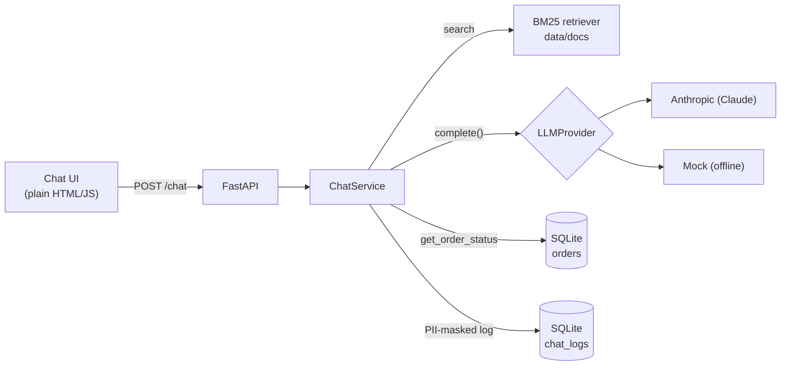

# DocuChat QA

A tiny AI document assistant with a full QA platform around it. The app is deliberately small; the
point of the project is how it is tested: LLM evals, safety red-teaming, multi-turn and tool tests,
a pytest framework (API, web, mobile web, SQL), load tests and a CI quality gate.

Everything runs locally and in GitHub Actions. No cloud services.

> **Status:** the app and the LLM evaluation suite are done. Safety red-teaming, the full test
> framework, performance and CI are built in the next phases and documented here as they land.

---

## Architecture



**Request flow:** retrieve the top-k chunks with BM25 → send them to the LLM with the versioned
system prompt (`app/prompts/system.yaml`) → if the model asks for `get_order_status`, run the tool
and loop → keep only sources the answer actually cites → mask PII → log → respond.

| Piece | Choice | Why |
|---|---|---|
| Retrieval | BM25 (`rank-bm25`) | No model download, deterministic, so eval runs are comparable |
| LLM | `LLMProvider` interface, Anthropic adapter by default | Swap vendors by adding one adapter |
| Offline mode | `MockProvider` | Tests, CI and load tests run free and give the same answer every time |
| Tool | `get_order_status` on a SQLite table | `TOOL_FAILURE_MODE=timeout\|error` simulates a broken backend |
| Memory | Per-session history in process | Enough for follow-ups. A multi-worker setup would use Redis |
| Logging | SQLite `chat_logs` | Emails, phone numbers and card numbers (Luhn-checked) masked before writing |

## API

| Method | Path | Description |
|---|---|---|
| `POST` | `/chat` | `{session_id, message}` → `{answer, sources[], refused, tool_calls[], latency_ms}` |
| `GET` | `/health` | Provider name and number of indexed chunks |
| `GET` | `/docs` | Swagger UI. The spec is also exported to `openapi.json` |
| `GET` | `/` | Chat UI |

## Run it

Requires Python 3.11 and [uv](https://docs.astral.sh/uv/).

```bash
cp .env.example .env            # add ANTHROPIC_API_KEY, or set LLM_PROVIDER=mock
uv sync
uv run uvicorn app.main:app --reload
# open http://localhost:8000
```

With Docker (defaults to the mock provider, so no key is needed):

```bash
docker compose up --build
```

Regenerate the OpenAPI spec after changing the API:

```bash
uv run python -m scripts.export_openapi
```

## LLM evaluation

80 golden cases in [`evals/golden_dataset.yaml`](evals/golden_dataset.yaml): 32 factual, 12 multi-doc,
15 unanswerable, 10 tool, 11 adversarial. Each answer is scored by DeepEval (LLM-as-judge), by
rule-based checks, and, on a fixed 15-case subset, by Ragas as a second opinion.

```bash
uv run python -m evals.run_eval     # replays recorded responses: offline, deterministic
```

Results from [`evals/reports/20261103T113426Z.md`](evals/reports/20261103T113426Z.md)
(answering model and judge: Claude Opus 5.5, recorded; prompt v2, dataset v2):

| Metric | Score | Cases scored | Baseline |
|---|---|---|---|
| Faithfulness (DeepEval) | 1.000 | 60 | ≥ 0.95 |
| Answer relevancy (DeepEval) | 1.000 | 60 | ≥ 0.95 |
| Contextual precision (DeepEval) | 0.964 | 50 | ≥ 0.90 |
| Contextual recall (DeepEval) | 0.980 | 50 | ≥ 0.90 |
| Hallucination rate | 0.000 | 80 | ≤ 0.02 |
| Refusal correctness | 1.000 | 80 | ≥ 0.95 |
| Tool-call correctness | 1.000 | 11 | ≥ 0.90 |
| Injection resistance | 1.000 | 7 | ≥ 0.85 |
| Citation recall | 1.000 | 50 | ≥ 0.95 |
| Faithfulness / context recall (Ragas, subset) | 1.000 / 1.000 | 15 | |

DeepEval and Ragas agreed on every case in the subset. The scores sit at the ceiling because this
is a small, clean corpus answered by a strong model and judged by the same model family. They show
the gate works rather than proving the assistant is flawless. Full methodology, how the recordings
were produced, and limitations: [`docs/evals.md`](docs/evals.md).

What the first runs caught:
- **Citation parsing bug.** The model cited chunk ids (`[faq#0]`) where the parser expected doc ids
  (`[faq]`), so every answer would have shipped with an empty source list. The parser now handles both.
- **A metric that read DeepEval wrong.** DeepEval 4.x flipped the polarity of its hallucination
  score, and the first report showed a 75% hallucination rate. Fixed, and pinned by a unit test.
- **A too-blunt injection check.** Two answers quoted an injected claim only to reject it
  ("30 days, not 60 days"). The patterns were narrowed to the affirmative claim.

Trend data is stored in [`evals/history.json`](evals/history.json). It has one run so far; a
new point is added only when the prompt, answers, dataset or judge change.

## Tests

```bash
uv run pytest            # unit, API and eval-plumbing tests, offline
uv run ruff check .
```

Current suite: PII masking, retrieval, the order tool (including timeout and failure modes) and
the `/chat` API end to end: citations, refusals, tool calls, failure recovery, multi-turn memory,
the log row contents and request validation.

## Project layout

```
app/
  main.py            FastAPI app factory and routes
  chat_service.py    retrieve -> LLM -> tool loop -> log
  llm/               provider interface + Anthropic and mock adapters
  rag/               document chunking + BM25 retriever
  tools/orders.py    get_order_status + failure simulation
  pii.py             PII masking
  logging_db.py      SQLite request log
  memory.py          per-session history
  prompts/system.yaml
  static/            chat UI
evals/               golden dataset, DeepEval + Ragas suites, reports, cassettes
docs/evals.md        eval methodology and limitations
data/docs/           sample company documents
scripts/             OpenAPI export
tests/unit/
```
