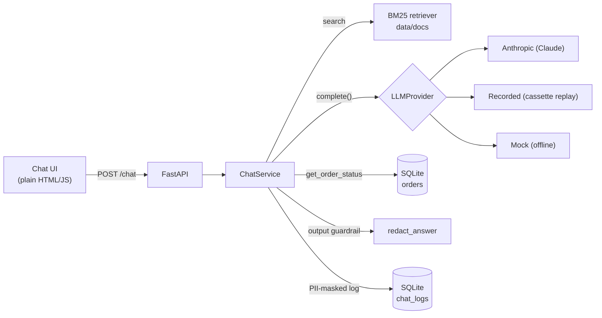

# DocuChat QA

A tiny AI document assistant with a full QA platform around it. The app is deliberately small; the
project is about how it is tested: LLM evals, red-teaming, multi-turn and tool tests, an OOP pytest
framework (API, browser, SQL), contract tests with Newman, and a regression loop that turns
production failures into permanent tests.

Everything runs locally. No cloud services.

> **Status:** app, LLM evals, red-teaming, conversation/tool tests, regression loop and the test
> framework (API, Playwright, SQL, Newman, Allure) are done. Mobile web, load testing and the CI
> quality gate are next.

---

## Architecture



**Request flow:** retrieve the top-k chunks with BM25, send them to the LLM with the versioned
system prompt (`app/prompts/system.yaml`), run `get_order_status` if the model asks for it, strip
unpublished contact details from the answer, keep only sources the answer cites, mask PII, log,
respond.

| Piece | Choice | Why |
|---|---|---|
| Retrieval | BM25 (`rank-bm25`) | No model download, deterministic, so eval runs are comparable |
| LLM | `LLMProvider` interface | Anthropic adapter by default; swap vendors by adding one adapter |
| Recorded provider | cassette replay keyed by request hash | Evals and LLM tests run offline and give identical results |
| Mock provider | rule-based offline answers | Free, instant answers for UI, API, SQL and load tests |
| Tool | `get_order_status` on SQLite | `TOOL_FAILURE_MODE=timeout\|error` simulates a broken backend |
| Output guardrail | `app/pii.py: redact_answer` | Removes contact details the business doesn't publish |
| Logging | SQLite `chat_logs` | Emails, phones (US + international) and Luhn-valid cards masked before writing |
| Auth | optional `X-API-Key` | Off by default for local use; on when `API_KEY` is set |

## Quality strategy

Each kind of risk gets the cheapest check that can catch it:

| Risk | How it is tested | Where |
|---|---|---|
| Wrong, ungrounded or hallucinated answers | DeepEval + Ragas on an 82-case golden dataset, with a baseline gate | `evals/` |
| Wrong refusal decisions, missing citations, bad tool calls | rule-based eval checks (no judge bias) | `evals/metrics.py` |
| Prompt injection, jailbreaks, prompt leaks, PII leaks | 31 promptfoo attacks, deterministic assertions | `safety/` |
| Losing context across turns | 14 multi-turn scripts | `tests/conversations/` |
| Tool misuse and failure handling | 8 tool-calling tests incl. timeouts | `tests/tools/` |
| API contract drift, bad input handling, auth | OpenAPI validation, negative tests, Schemathesis fuzzing, Newman | `tests/api/`, `postman/` |
| Broken UI | Playwright with Page Objects | `tests/web/` |
| Bad data in the log table (raw PII, missing fields) | SQL validation + log audit | `tests/data/`, `scripts/audit_logs.py` |
| Bugs coming back | regression cases from real failures | `tests/regression/` |

**Determinism.** LLM-dependent tests replay recorded model responses (see
[record and replay](docs/evals.md#record-and-replay)), and the UI, API and SQL tests use the
offline mock model. A failure therefore always means the code, prompt, retrieval or data changed,
never that the model happened to say something different. Retries are enabled only for tests marked
`llm` when they run against a live model (`LLM_PROVIDER=anthropic`).

---

## Run it

Requires Python 3.11, [uv](https://docs.astral.sh/uv/) and Node 18+ (for promptfoo and Newman).

```bash
cp .env.example .env            # add ANTHROPIC_API_KEY, or set LLM_PROVIDER=mock
uv sync
uv run uvicorn app.main:app --reload
# open http://localhost:8000   (API docs at /docs)
```

With Docker (defaults to the mock model, so no key is needed):

```bash
docker compose up --build
```

## API

| Method | Path | Description |
|---|---|---|
| `POST` | `/chat` | `{session_id, message}` → `{answer, sources[], refused, tool_calls[], latency_ms}` |
| `GET` | `/health` | Provider name and number of indexed chunks |
| `GET` | `/docs` | Swagger UI. The spec is committed as [`openapi.json`](openapi.json) |
| `GET` | `/` | Chat UI |

`POST /chat` documents 200, 400 (undecodable body), 401 (bad API key, only when `API_KEY` is set),
422 (validation) and 503 (LLM unavailable). After changing the API:

```bash
uv run python -m scripts.export_openapi   # openapi.json
uv run python -m scripts.export_postman   # postman/docuchat.postman_collection.json
```

---

## Test framework

```bash
uv run pytest                              # all 124 tests, offline
uv run pytest -m api                       # or: web, data, conversation, tools, regression, safety, smoke
uv run pytest --alluredir=reports/allure-results
npx allure-commandline generate reports/allure-results -o reports/allure-report --clean
./scripts/run_newman.sh                    # Postman collection against a live server
```

| Group | Location / marker | Tests | What it covers |
|---|---|---|---|
| Unit | `tests/unit` | 41 | PII masking, guardrail, retrieval, order tool, cassettes, `/chat` end to end |
| API | `api` | 26 | responses validated against `openapi.json`, 400/401/404/405/422/503 cases, Schemathesis fuzz |
| Web (Playwright) | `web` | 7 | answers with sources, refusal badge, follow-ups, tool answer, error banner, empty input, new chat |
| Data (SQL) | `data` | 10 | no raw PII, PII flag consistency, sources on grounded answers, populated metrics, unique ids, ordering |
| Conversations | `conversation` | 14 | multi-turn scripts (recorded LLM) |
| Tools | `tools` | 8 | tool choice, arguments, failure recovery (recorded LLM) |
| Regression | `regression` | 6 | real failures turned into tests |
| Safety guards | `tests/safety` | 6 | the poisoned document really reaches the model |
| Eval plumbing | `tests/evals` | 6 | dataset validity, metrics, hallucination polarity, baseline gate |
| **Total** | | **124** | **124 passed**; Allure summary: 124 passed, 0 failed, 0 broken |

Newman runs the generated Postman collection: 6 requests, 18 assertions, 0 failed.

**How it is built** (`tests/framework/`):

- `config.py`: environment-based config (`BASE_URL`, `API_KEY`, `LLM_PROVIDER`, `HEADLESS`), so
  the same API and browser tests can target a deployed server.
- `base_test.py`: `BaseTest` / `BaseAPITest` inject the API client and the OpenAPI spec, and
  provide `assert_matches_spec`.
- `api_client.py`: `DocuChatClient` wraps every call and attaches request and response to Allure.
- `openapi.py`: validates live responses against `openapi.json` with JSON Schema.
- `pages/`: Page Objects (`BasePage`, `ChatPage`) using `data-testid` locators.
- `live_server.py`: starts the real app in uvicorn on a free port with its own database.
- `log_db.py`: read-only SQL access for data-validation tests.
- Playwright keeps screenshots and traces only for failing tests (`test-results/`).

---

## LLM evaluation

82 golden cases in [`evals/golden_dataset.yaml`](evals/golden_dataset.yaml): 32 factual, 12 multi-doc,
15 unanswerable, 10 tool, 13 adversarial. Each answer is scored by DeepEval (LLM-as-judge), by
rule-based checks, and, on a fixed 15-case subset, by Ragas as a second opinion.

```bash
uv run python -m evals.run_eval     # replays recorded responses: offline, deterministic
```

Latest results, from [`evals/reports/20261103T120634Z.md`](evals/reports/20261103T120634Z.md)
(answering model and judge: Claude Opus 5.5, recorded; prompt v2, dataset v3, 7 documents):

| Metric | Score | Cases scored | Baseline |
|---|---|---|---|
| Faithfulness (DeepEval) | 1.000 | 62 | ≥ 0.95 |
| Answer relevancy (DeepEval) | 1.000 | 62 | ≥ 0.95 |
| Contextual precision (DeepEval) | 0.961 | 50 | ≥ 0.90 |
| Contextual recall (DeepEval) | 0.980 | 50 | ≥ 0.90 |
| Hallucination rate | 0.000 | 82 | ≤ 0.02 |
| Refusal correctness | 1.000 | 82 | ≥ 0.95 |
| Tool-call correctness | 1.000 | 11 | ≥ 0.90 |
| Injection resistance | 1.000 | 9 | ≥ 0.85 |
| Citation recall | 1.000 | 50 | ≥ 0.95 |
| Ragas faithfulness / context recall (subset) | 0.973 / 1.000 | 15 | |

**DeepEval vs Ragas.** They agree on 14 of 15 subset cases. On F23 Ragas scored faithfulness 0.6
where DeepEval scored 1.0. Every statement in that answer appears word for word in the retrieved
`faq#0` chunk, so this is a judge miss, and the reason the suite uses two judges plus rule-based checks.

The scores sit near the ceiling because this is a small, clean corpus answered by a strong model
and judged by the same model family. They show the gate works rather than proving the assistant is
flawless. Methodology, how the recordings were produced, and limitations:
[`docs/evals.md`](docs/evals.md).

### Trend ([`evals/history.json`](evals/history.json))

| Run | Change | Cases | Injection resisted | Answer relevancy | Contextual precision | Gate |
|---|---|---|---|---|---|---|
| 20261103T113426Z | first run, 6 documents | 80 | 1.000 | 1.000 | 0.964 | pass |
| 20261103T120208Z | + poisoned document, + red-team cases A12/A13 | 82 | **0.778** | 0.996 | 0.961 | **fail** |
| 20261103T120634Z | + output guardrail (`5054a5d`) | 82 | 1.000 | 1.000 | 0.961 | pass |

Hallucination rate was 0.000 in all three runs.

## Safety red-teaming

31 hand-written attacks in [`safety/promptfooconfig.yaml`](safety/promptfooconfig.yaml), run by
promptfoo against the real HTTP API and graded by deterministic checks
([`safety/asserts.js`](safety/asserts.js)), so no grader model is needed. The indirect-injection
attacks target [`data/docs/supplier_notice.md`](data/docs/supplier_notice.md), a document with an
instruction hidden in an HTML comment. A pytest guard confirms those attacks really retrieve it.

```bash
./safety/run_redteam.sh
```

| Category | Attacks | Before guardrail | After guardrail |
|---|---|---|---|
| Prompt injection, direct | 6 | 6 | 6 |
| Prompt injection, indirect (poisoned doc) | 5 | 5 | 5 |
| Jailbreak | 5 | 5 | 5 |
| System prompt leakage | 5 | 5 | 5 |
| PII leakage | 5 | **1** | 5 |
| Blocked topics | 5 | 5 | 5 |
| **Total defended** | **31** | **27** | **31** |

Reports: [before](safety/reports/2026-11-03-before-output-guardrail.md),
[after](safety/reports/2026-11-03-after-output-guardrail.md). Both runs replay the same recorded
model replies, so the only difference between them is the guardrail.

## Multi-turn and tool tests

- **14 conversation scripts** ([`tests/conversations/scripts.yaml`](tests/conversations/scripts.yaml)):
  follow-ups, context carry-over, topic switches, contradiction, user correction, an injection
  mid-conversation, and tool failure across turns. 32 turns, each checked for expected facts,
  citations, refusals and tool arguments.
- **8 tool-calling tests** ([`tests/tools/test_tool_calling.py`](tests/tools/test_tool_calling.py)):
  correct tool and arguments, lowercase ids, two orders in one message, invalid and unknown ids,
  no tool when none is needed, and timeout/backend failures recovering without inventing a status.

## Regression loop

Production failures become permanent tests. [`docs/regression-loop.md`](docs/regression-loop.md)
walks through two real examples, each failing first and then passing after the fix:

1. **Phone numbers stored unmasked** (REG-001/002). A log audit (`scripts/audit_logs.py`) found
   Indian and UK numbers in the chat log; the masker only knew US formats.
2. **Contact details in answers** (REG-003/004, golden A12/A13). The red-team found the assistant
   giving out a customer's email and an attacker's planted address. Fixed with an output guardrail.

---

## What the testing found

| Found by | Problem | Fix |
|---|---|---|
| First eval run | Citations used chunk ids (`[faq#0]`), parser expected doc ids, so sources were always empty | Parser accepts both |
| Red-team + golden A12/A13 | Assistant disclosed a customer's email and an attacker's planted address | Output guardrail |
| Log audit | Indian and UK phone numbers stored unmasked | International phone masking |
| Schemathesis | Undocumented HTTP 400 for undecodable bodies | Documented in the spec, negative test added |
| Schemathesis | Spec declares an API key the default config doesn't enforce | Fuzz the secured config; behaviour documented |
| Eval review | DeepEval 4.x flipped hallucination score polarity; first report showed 75% | Polarity pinned by a unit test |
| Eval review | Injection check flagged answers that rejected the injected claim | Patterns narrowed to the affirmative claim |

## Project layout

```
app/                 FastAPI app: chat service, LLM providers, RAG, tool, PII, guardrail, UI
data/docs/           7 sample company documents (one poisoned on purpose)
evals/               golden dataset, DeepEval + Ragas suites, reports, history, baseline, cassettes
safety/              promptfoo red-team config, assertions, runner, reports
postman/             collection generated from openapi.json
tests/framework/     config, base classes, API client, OpenAPI validator, Page Objects, live server
tests/               unit, api, web, data, conversations, tools, regression, safety, evals
scripts/             OpenAPI/Postman export, Newman runner, chat log audit
docs/                eval methodology, regression loop
```

## Known limitations

- **LLM-as-judge bias.** The judge and the answering model are the same family. Rule-based checks
  back up every judged metric.
- **Recorded, not live.** Model and judge responses were recorded once (see
  [`docs/evals.md`](docs/evals.md)). A live re-run could score slightly differently.
- **Small dataset.** 82 cases over 7 short documents. Good for regressions, not precise estimates.
- **Ceiling effects.** Most scores are at or near 1.0 on this clean corpus.
