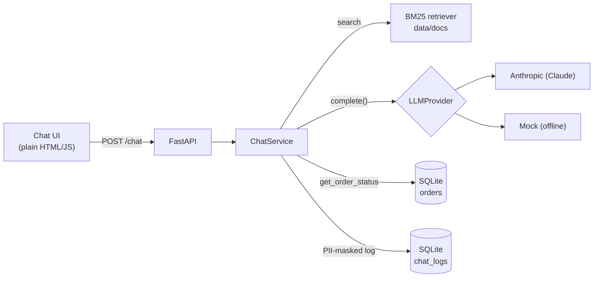

# DocuChat QA

A tiny AI document assistant with a full QA platform around it. The app is deliberately small; the
point of the project is how it is tested: LLM evals, safety red-teaming, multi-turn and tool tests,
a pytest framework (API, web, mobile web, SQL), load tests and a CI quality gate.

Everything runs locally and in GitHub Actions. No cloud services.

> **Status:** Phase 1 (the app) is done. Evals, safety, the test framework, performance and CI
> are built in the next phases and will be documented here as they land.

---

## Architecture



**Request flow:** retrieve the top-k chunks with BM25 → send them to the LLM with the versioned
system prompt (`app/prompts/system.yaml`) → if the model asks for `get_order_status`, run the tool
and loop → keep only sources the answer actually cites → mask PII → log → respond.

| Piece | Choice | Why |
|---|---|---|
| Retrieval | BM25 (`rank-bm25`) | No model download, deterministic, so eval runs are comparable |
| LLM | `LLMProvider` interface, Anthropic adapter by default | Swap vendors by adding one adapter |
| Offline mode | `MockProvider` | Tests, CI and load tests run free and give the same answer every time |
| Tool | `get_order_status` on a SQLite table | `TOOL_FAILURE_MODE=timeout\|error` simulates a broken backend |
| Memory | Per-session history in process | Enough for follow-ups. A multi-worker setup would use Redis |
| Logging | SQLite `chat_logs` | Emails, phone numbers and card numbers (Luhn-checked) masked before writing |

## API

| Method | Path | Description |
|---|---|---|
| `POST` | `/chat` | `{session_id, message}` → `{answer, sources[], refused, tool_calls[], latency_ms}` |
| `GET` | `/health` | Provider name and number of indexed chunks |
| `GET` | `/docs` | Swagger UI. The spec is also exported to `openapi.json` |
| `GET` | `/` | Chat UI |

## Run it

Requires Python 3.11 and [uv](https://docs.astral.sh/uv/).

```bash
cp .env.example .env            # add ANTHROPIC_API_KEY, or set LLM_PROVIDER=mock
uv sync
uv run uvicorn app.main:app --reload
# open http://localhost:8000
```

With Docker (defaults to the mock provider, so no key is needed):

```bash
docker compose up --build
```

Regenerate the OpenAPI spec after changing the API:

```bash
uv run python -m scripts.export_openapi
```

## Tests

```bash
uv run pytest            # unit + API tests, offline (mock LLM)
uv run ruff check .
```

Current suite: PII masking, retrieval, the order tool (including timeout and failure modes) and
the `/chat` API end to end: citations, refusals, tool calls, failure recovery, multi-turn memory,
the log row contents and request validation.

## Project layout

```
app/
  main.py            FastAPI app factory and routes
  chat_service.py    retrieve -> LLM -> tool loop -> log
  llm/               provider interface + Anthropic and mock adapters
  rag/               document chunking + BM25 retriever
  tools/orders.py    get_order_status + failure simulation
  pii.py             PII masking
  logging_db.py      SQLite request log
  memory.py          per-session history
  prompts/system.yaml
  static/            chat UI
data/docs/           sample company documents
scripts/             OpenAPI export
tests/unit/
```
