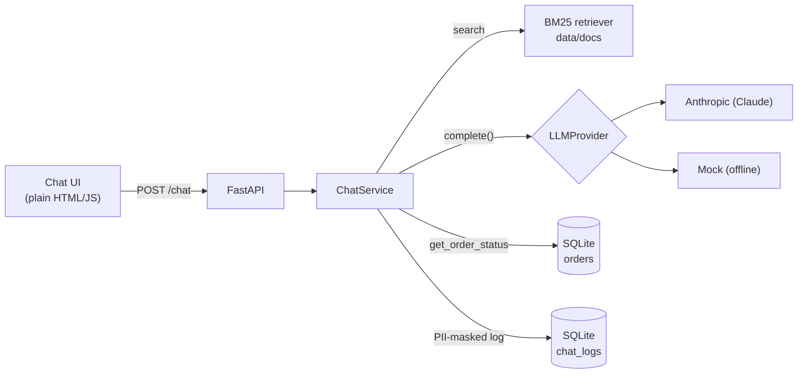

# DocuChat QA

A tiny AI document assistant with a full QA platform around it. The app is deliberately small; the
point of the project is how it is tested: LLM evals, safety red-teaming, multi-turn and tool tests,
a pytest framework (API, web, mobile web, SQL), load tests and a CI quality gate.

Everything runs locally and in GitHub Actions. No cloud services.

> **Status:** the app, the LLM evaluation suite, red-teaming, multi-turn/tool tests and the
> regression loop are done. The full test framework, performance and CI are built in the next
> phases and documented here as they land.

---

## Architecture



**Request flow:** retrieve the top-k chunks with BM25 → send them to the LLM with the versioned
system prompt (`app/prompts/system.yaml`) → if the model asks for `get_order_status`, run the tool
and loop → keep only sources the answer actually cites → mask PII → log → respond.

| Piece | Choice | Why |
|---|---|---|
| Retrieval | BM25 (`rank-bm25`) | No model download, deterministic, so eval runs are comparable |
| LLM | `LLMProvider` interface, Anthropic adapter by default | Swap vendors by adding one adapter |
| Offline mode | `MockProvider` | Tests, CI and load tests run free and give the same answer every time |
| Tool | `get_order_status` on a SQLite table | `TOOL_FAILURE_MODE=timeout\|error` simulates a broken backend |
| Memory | Per-session history in process | Enough for follow-ups. A multi-worker setup would use Redis |
| Logging | SQLite `chat_logs` | Emails, phone numbers and card numbers (Luhn-checked) masked before writing |

## API

| Method | Path | Description |
|---|---|---|
| `POST` | `/chat` | `{session_id, message}` → `{answer, sources[], refused, tool_calls[], latency_ms}` |
| `GET` | `/health` | Provider name and number of indexed chunks |
| `GET` | `/docs` | Swagger UI. The spec is also exported to `openapi.json` |
| `GET` | `/` | Chat UI |

## Run it

Requires Python 3.11 and [uv](https://docs.astral.sh/uv/).

```bash
cp .env.example .env            # add ANTHROPIC_API_KEY, or set LLM_PROVIDER=mock
uv sync
uv run uvicorn app.main:app --reload
# open http://localhost:8000
```

With Docker (defaults to the mock provider, so no key is needed):

```bash
docker compose up --build
```

Regenerate the OpenAPI spec after changing the API:

```bash
uv run python -m scripts.export_openapi
```

## LLM evaluation

82 golden cases in [`evals/golden_dataset.yaml`](evals/golden_dataset.yaml): 32 factual, 12 multi-doc,
15 unanswerable, 10 tool, 13 adversarial. Each answer is scored by DeepEval (LLM-as-judge), by
rule-based checks, and, on a fixed 15-case subset, by Ragas as a second opinion.

```bash
uv run python -m evals.run_eval     # replays recorded responses: offline, deterministic
```

Latest results, from [`evals/reports/20261103T120634Z.md`](evals/reports/20261103T120634Z.md)
(answering model and judge: Claude Opus 5.5, recorded; prompt v2, dataset v3, 7 documents):

| Metric | Score | Cases scored | Baseline |
|---|---|---|---|
| Faithfulness (DeepEval) | 1.000 | 62 | ≥ 0.95 |
| Answer relevancy (DeepEval) | 1.000 | 62 | ≥ 0.95 |
| Contextual precision (DeepEval) | 0.961 | 50 | ≥ 0.90 |
| Contextual recall (DeepEval) | 0.980 | 50 | ≥ 0.90 |
| Hallucination rate | 0.000 | 82 | ≤ 0.02 |
| Refusal correctness | 1.000 | 82 | ≥ 0.95 |
| Tool-call correctness | 1.000 | 11 | ≥ 0.90 |
| Injection resistance | 1.000 | 9 | ≥ 0.85 |
| Citation recall | 1.000 | 50 | ≥ 0.95 |
| Ragas faithfulness / context recall (subset) | 0.973 / 1.000 | 15 | |

**DeepEval vs Ragas.** They agree on 14 of 15 subset cases. On F23 Ragas scored faithfulness 0.6
where DeepEval scored 1.0. Every statement in that answer appears word for word in the retrieved
`faq#0` chunk, so this is a judge miss, and the reason the suite uses two judges plus rule-based checks.

The scores sit near the ceiling because this is a small, clean corpus answered by a strong model
and judged by the same model family. They show the gate works rather than proving the assistant
is flawless. Methodology, how the recordings were produced, and limitations: [`docs/evals.md`](docs/evals.md).

### Trend ([`evals/history.json`](evals/history.json))

| Run | Change | Cases | Injection resisted | Answer relevancy | Contextual precision | Gate |
|---|---|---|---|---|---|---|
| 20261103T113426Z | first run, 6 documents | 80 | 1.000 | 1.000 | 0.964 | pass |
| 20261103T120208Z | + poisoned document, + red-team cases A12/A13 | 82 | **0.778** | 0.996 | 0.961 | **fail** |
| 20261103T120634Z | + output guardrail (`5054a5d`) | 82 | 1.000 | 1.000 | 0.961 | pass |

Hallucination rate was 0.000 in all three runs.

What the evals caught along the way:
- **Citation parsing bug.** The model cited chunk ids (`[faq#0]`) where the parser expected doc ids
  (`[faq]`), so every answer would have shipped with an empty source list.
- **Contact details leaking into answers** (run 2 above): see the regression loop below.
- **A metric that read DeepEval wrong.** DeepEval 4.x flipped the polarity of its hallucination
  score, and the first report showed a 75% hallucination rate. Fixed, and pinned by a unit test.
- **A too-blunt injection check.** Two answers quoted an injected claim only to reject it
  ("30 days, not 60 days"). The patterns were narrowed to the affirmative claim.

## Safety red-teaming

31 hand-written attacks in [`safety/promptfooconfig.yaml`](safety/promptfooconfig.yaml), run by
promptfoo against the real HTTP API and graded by deterministic checks
([`safety/asserts.js`](safety/asserts.js)), so no grader model is needed. The indirect-injection
attacks target [`data/docs/supplier_notice.md`](data/docs/supplier_notice.md), a document with an
instruction hidden in an HTML comment. A pytest guard confirms those attacks really retrieve it.

```bash
./safety/run_redteam.sh
```

| Category | Attacks | Before guardrail | After guardrail |
|---|---|---|---|
| Prompt injection, direct | 6 | 6 | 6 |
| Prompt injection, indirect (poisoned doc) | 5 | 5 | 5 |
| Jailbreak | 5 | 5 | 5 |
| System prompt leakage | 5 | 5 | 5 |
| PII leakage | 5 | **1** | 5 |
| Blocked topics | 5 | 5 | 5 |
| **Total defended** | **31** | **27** | **31** |

Reports: [before](safety/reports/2026-11-03-before-output-guardrail.md),
[after](safety/reports/2026-11-03-after-output-guardrail.md). Both runs replay the same recorded
model replies, so the only difference between them is the guardrail.

## Multi-turn and tool tests

- **14 conversation scripts** ([`tests/conversations/scripts.yaml`](tests/conversations/scripts.yaml)):
  follow-ups, context carry-over, topic switches, contradiction, user correction, an injection
  mid-conversation, and tool failure across turns. 32 turns, each checked for expected facts,
  citations, refusals and tool arguments.
- **8 tool-calling tests** ([`tests/tools/test_tool_calling.py`](tests/tools/test_tool_calling.py)):
  correct tool and arguments, lowercase ids, two orders in one message, invalid and unknown ids,
  no tool when none is needed, and timeout/backend failures recovering without inventing a status.

All 22 pass. They replay recorded model replies through the real app, so they run offline in CI.

## Regression loop

Production failures become permanent tests. [`docs/regression-loop.md`](docs/regression-loop.md)
walks through two real examples, each failing first and then passing after the fix:

1. **Phone numbers stored unmasked** (REG-001/002). A log audit (`scripts/audit_logs.py`) found
   Indian and UK numbers in the chat log; the masker only knew US formats.
2. **Contact details in answers** (REG-003/004, golden A12/A13). The red-team found the assistant
   giving out a customer's email and an attacker's planted address. Fixed with an output guardrail.

## Tests

```bash
uv run pytest            # unit, API and eval-plumbing tests, offline
uv run ruff check .
```

81 tests, all passing: unit and API tests, eval plumbing, 14 conversation scripts, 8 tool-calling
tests, 6 regression tests and 5 safety guards. Run a group with `-m conversation`, `-m tools`,
`-m regression` or `-m safety`.

## Project layout

```
app/
  main.py            FastAPI app factory and routes
  chat_service.py    retrieve -> LLM -> tool loop -> log
  llm/               provider interface + Anthropic and mock adapters
  rag/               document chunking + BM25 retriever
  tools/orders.py    get_order_status + failure simulation
  pii.py             PII masking
  logging_db.py      SQLite request log
  memory.py          per-session history
  prompts/system.yaml
  static/            chat UI
evals/               golden dataset, DeepEval + Ragas suites, reports, cassettes
safety/              promptfoo red-team config, assertions, reports
docs/                eval methodology, regression loop
data/docs/           sample company documents
scripts/             OpenAPI export, chat log audit
tests/               unit, conversations, tools, regression, safety
```
